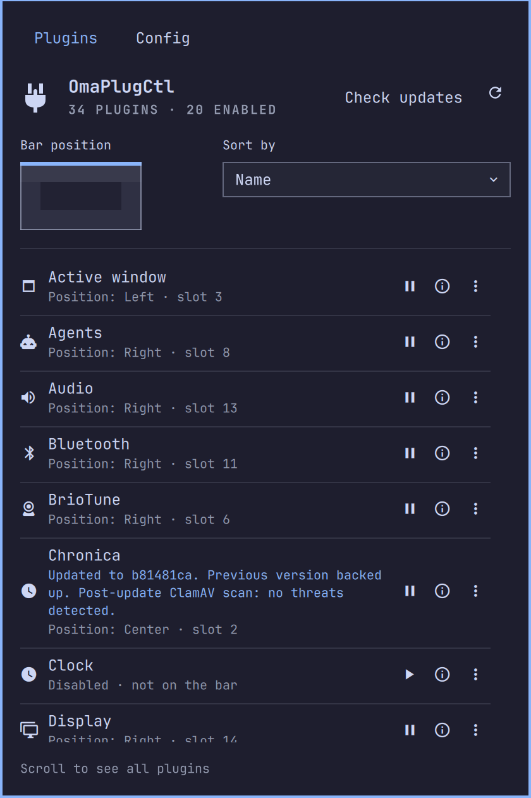

# OmaPlugCtl

Find, install, enable, arrange and update Omarchy plugins from one menu.

Click the plug icon in the bar to see what is running, move the bar to another screen edge, or update an installed plugin without leaving the menu.



## Install

Requires Omarchy’s Quickshell shell and plugin commands, plus Git and Python 3.

Install ClamAV for local malware checks, then add the plugin:

```bash
omarchy pkg add clamav
omarchy plugin add https://github.com/zigmoo/omaplugctl.git --enable
```

The plug icon appears in the bar’s right section. Open it to manage your installed bar plugins, including OmaPlugCtl itself.

## The plugin list

Each row shows a plugin’s name, bar position and update status. Hover the row for its description, local update date, author and whether it ships with Omarchy.

| Control | Action |
| --- | --- |
| Pause or play | Disable or enable the plugin. |
| Update arrows | Update this plugin when a source update is available. Hover for the latest change date and up to three commit subjects. |
| Information | Open the plugin’s source page. |
| Three dots | Move an instance to another bar section, or uninstall an installed third-party plugin. |

Uninstall asks for confirmation and removes the plugin’s local checkout. Disabling keeps its files. Built-in plugins cannot be uninstalled here; OmaPlugCtl keeps itself enabled so its controls remain available.

If a plugin provides no meaningful author attribution, OmaPlugCtl traces its manifest and entry-point files through Git history to their first recorded commits. The hover footer identifies the author and commit; shallow histories are labeled as the earliest available record.

## Move the bar

Click an edge of the little screen diagram to move the bar there. The highlighted edge is the current position; the other three remain faintly visible.

The menu moves with the bar and stays open, even when switching between horizontal and vertical placement. You can try another edge immediately without searching for the plug icon again.

## Find and arrange plugins

**Sort by** offers three views:

- **Screen order**, the default, follows the bar’s sections and slots, then lists plugins without a position.
- **Name** sorts alphabetically.
- **Pending update date** puts pending updates first, newest change first.

Sorting changes the list, not the bar. To move a plugin, open its three-dot controls and choose a destination section. Plugins with multiple bar instances have a separate movement control for each instance.

## Update a plugin

Click **Check updates** to fetch installed source repositories and look for changes. The refresh icon reloads local state without contacting upstream repositories.

When an update icon appears, hover it to see what changed, then click to update. The work happens in the background; progress and the result appear in the menu. The first scanned update may take longer while ClamAV downloads its signatures.

Updates apply to the checkout actually running the plugin, including the target of a symlink. Local edits and unmatched local commits are preserved. Built-in plugins in Omarchy’s shared repository are updated with `omarchy update`.

If an update stops, read the row or footer message for the reason. Common causes are local changes, divergent commits, missing ClamAV, or a failed scan. Resolve the cause, then check again. [How updates work](docs/updates.md) explains reconciliation, backups and scanning limits.

## Config

The **Config** tab holds bar icon size, the minimum number of workspace buttons, the saved sort order and **Scan with ClamAV before updating**, which defaults to on. Settings appear as saved only after Omarchy confirms them.

Bar icon size ranges from **50% to 200%** of the current theme. **Reset** restores 100%. It changes shared bar icon sizing while preserving text size. Widgets with their own fixed sizing may behave differently.

The workspace control sets how many buttons are always visible, from **0 to 10**. Existing workspaces remain visible; reducing the number does not close workspaces or move windows. It requires a workspace widget that exposes a count setting. [Workspace integration](docs/workspaces.md) explains support for custom clones.

ClamAV checks the fetched source locally before an update changes the checkout. Signatures refresh as needed, at most once per day. Plugin contents are never uploaded to a scanning service.

A detection, scanner error or incomplete scan stops the update. A clean result means **no threats detected**, not proof of safety. Turning the toggle off explicitly skips scanning for subsequent updates.

## Install new plugins

The third tab, **Install**, searches the [Omarchy marketplace](https://plugins.omarchy.org/). Type a name, description, author or tag; multiple words narrow the results together. **Verified only** is selected initially. Turn it off to include unverified listings and listings whose newer upstream update is unverified. Already installed plugins stay identifiable in the results.

The first visit downloads the catalog. Later visits reuse the saved copy and read the installed state again. Searching never contacts a server. **Refresh** downloads a new catalog; the displayed refresh time tells you how old the saved copy is. If a refresh fails, the saved results remain available with an explanatory message.

**Source** opens the repository. **Install** uses Omarchy's native installer and leaves the plugin disabled. After Omarchy confirms installation, the button becomes **Enable**. Enabling is a separate action and is also confirmed against Omarchy's installed state. Plugins requiring manual setup have a disabled action; use Source for their instructions.

Marketplace verification covers the listed commit. The native installer fetches current upstream code, which can have changed since that verification. The Install tab keeps snapshot and update verification distinct; it does not pin installations to a verified commit or apply the update-only ClamAV setting to new installs. The [marketplace verification guide](https://github.com/omacom/omarchy-plugin-marketplace/blob/main/VERIFICATION.md) describes the evidence and its limits.

## Commands

```bash
omarchy-shell moo.omaplugctl show
omarchy-shell moo.omaplugctl hide
omarchy-shell moo.omaplugctl status
omarchy-shell moo.omaplugctl tab install
```

To remove OmaPlugCtl itself:

```bash
omarchy plugin remove moo.omaplugctl
```

## Description for Agents

OmaPlugCtl manages Omarchy bar plugins (in the super-k menu it's called the 'top bar') from a menu that stays open when the bar moves. Enable or disable plugins, move their bar instances, and sort by screen order, name or pending update date. Hover rows for function, author and local update date, including upstream provenance for local clones. The Install tab searches the saved marketplace catalog as you type, defaults to verified listings, and installs plugins disabled with a separate Enable action. Check source repositories and update individual running checkouts, with local ClamAV scanning enabled by default and protection for local changes. Adjust bar icon size and, with a supported workspace widget, the minimum workspace button count in Config.

## Development

See the [development guide](docs/development.md) for local checkouts, architecture, verification and the archived agent-review experiment. Report problems through [GitHub issues](https://github.com/zigmoo/omaplugctl/issues), including the message shown and the affected plugin’s source repository.
